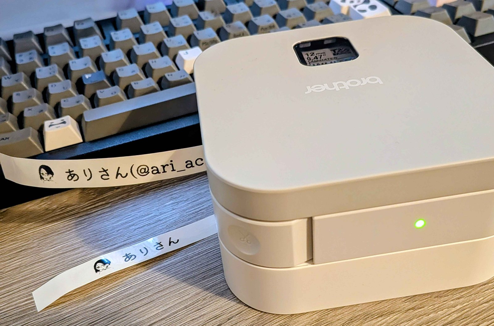
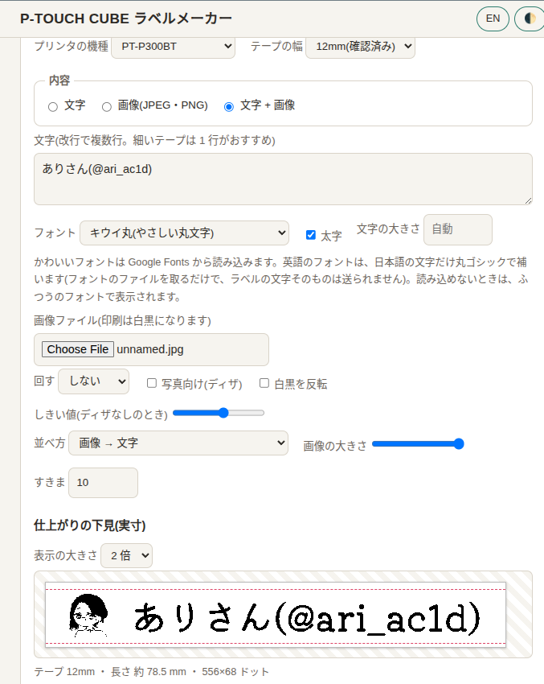

# p-touch-cube-mcp

[](https://github.com/RRYZ09/p-touch-cube-mcp/actions/workflows/ci.yml)
[](https://github.com/RRYZ09/p-touch-cube-mcp/releases)
[](LICENSE)


[English](README_EN.md) ・ **日本語**

**Brother [P-touch CUBE (PT-P300BT)](https://www.brother.co.jp/product/labelwriter/special/cube/about/index.aspx) に、Claude から話しかけてラベルを印刷する** MCP サーバーです。
ブラウザで編集して印刷できる[**「P-TOUCH CUBE ラベルメーカー」**](https://rryz09.github.io/p-touch-cube-mcp/)(日本語・English、ライト・ダーク対応)もあります。

```
あなた: 「おみやげ」って書いたラベルを作って。まず下見だけ見せて。
Claude: (下見の画像を作る) こんな見た目です。刷りますか?
あなた: 刷って。
Claude: (プリンタに送る) 1 枚印刷しました。
```

<p align="center">
  
</p>

<p align="center">
  <em>PT-P300BT で、画像と文字を並べて印刷したラベル(12mm のラミネートテープ)</em>
</p>

公式アプリ([P-touch Design&Print](https://www.brother.co.jp/product/labelwriter/special/cube/about/index.aspx))を使わず、パソコンから直接つなぎます。
アプリには「文字 1 つ・アイコン 3 つまで」などの制限がありますが、ここでは好きな文字や、JPEG の画像もラベルにできます。

**非公式の使い方です。** Brother の公式サポートの範囲外なので、自己責任でお使いください。

### 印刷ページの画面

<p align="center">
  
</p>

画像と文字を並べて、テープの実寸で下見を見ながら印刷できます。

## 使い方は 2 つ

| | こんな人に | 必要なもの |
|---|---|---|
| **[ラベルメーカー](https://rryz09.github.io/p-touch-cube-mcp/)**(ブラウザ) | 手軽に刷りたい。インストールしたくない | パソコンの Chrome か Edge(Web Serial 対応)。ペアリング済みのプリンタ |
| **MCP / コマンドライン** | Claude に頼んで刷りたい。自動化したい | Linux、Python、uv |

どちらも、先に**パソコンとプリンタのペアリング**が要ります(下の手順 2)。

## 何ができるか(MCP)

| ツール | 内容 |
|---|---|
| `print_label_text` | 文字を印刷します。日本語 OK、改行で複数行。`image_path` を渡すと、画像と文字を横に並べます(`image_position`: `left` / `right` / `both`=画像で文字を挟む / `between`=文字で画像を挟む、後ろの文字は `text_after`)。`tape_mm` でテープの幅(3.5〜24)、`font_path` で好きなフォントを、`latin_font_path` で半角の英数字だけ別のフォントを、`segments` で文字ごとのフォントを選べます。`dry_run` を付けると、印刷せずに仕上がりの PNG だけ作ります |
| `print_label_image` | JPEG・PNG を白黒にして印刷します。テープの幅に合わせて縮み、回転もできます |
| `printer_status` | テープの幅・種類・エラーの有無を読みます。「つながっているか」の確認にも使います |

## 用意するもの

- Brother **PT-P300BT**(P-touch CUBE)と、12mm 幅のテープ
- MCP・コマンドライン: **Linux** のパソコンで Bluetooth が使えるもの(Ubuntu 24.04 で動作確認)、Python 3.10 以上、[uv](https://docs.astral.sh/uv/)
- 印刷ページ: パソコンの Chrome か Edge(Safari・Firefox・iPhone・iPad では動きません)

macOS と Windows の MCP・コマンドライン版は、いまは動きません(Python の Bluetooth ソケットを使っているため)。印刷ページなら、Chrome があれば動く可能性があります。対応のお手伝いは歓迎です([CONTRIBUTING.md](CONTRIBUTING.md))。

## クイックスタート

### 1. 取ってくる(MCP・コマンドライン)

```sh
git clone https://github.com/RRYZ09/p-touch-cube-mcp.git
cd p-touch-cube-mcp
uv sync
```

### 2. プリンタとペアリングする(初回だけ。印刷ページも同じ)

プリンタの電源を入れてから、次を実行します。

```sh
bluetoothctl
> scan on                 # 「PT-P300BT」と数字が出たら、そのアドレスを控える
> pair XX:XX:XX:XX:XX:XX  # 控えたアドレス
> trust XX:XX:XX:XX:XX:XX
> exit
```

`sudo` も `rfcomm bind` も要りません。

### 3. つながるか確かめる

アドレスは環境変数で渡します。**アドレスはファイルに書かないでください**(公開リポジトリに入れてしまう事故を防ぐため)。

```sh
export PTOUCH_ADDR=XX:XX:XX:XX:XX:XX
uv run p-touch-cube status
```

`"ok": true` と、テープの幅(`"tape_mm": 12`)が出れば成功です。

### 4. まず下見、次に印刷

```sh
uv run p-touch-cube text "ラベル" --dry-run   # out/ に仕上がりの PNG ができる(テープは使わない)
uv run p-touch-cube text "ラベル"             # 印刷
uv run p-touch-cube text "ラベル" --tape-mm 9 --image heart.png --dry-run   # 9mm テープ、ハート+文字
uv run p-touch-cube text "Label" --font ~/.fonts/Fredoka.ttf --dry-run     # 好きなフォントで
uv run p-touch-cube text "Label ラベル" --font ja.ttf --latin-font en.ttf --dry-run   # 日本語と英数字で別のフォント
uv run p-touch-cube text x --segment "ラベル=ja.ttf" --segment "Label=en.ttf" --dry-run   # 文字ごとのフォント
uv run p-touch-cube image photo.jpg --dry-run
```

### 5. Claude Code から使う

```sh
claude mcp add p-touch-cube --env PTOUCH_ADDR=XX:XX:XX:XX:XX:XX \
  -- uv run --directory /path/to/p-touch-cube-mcp p-touch-cube-mcp
```

登録したあと、Claude Code を開き直してください。あとは「ラベルを作って」と頼むだけです。
**テープを使うので、最初の 1 枚は、下見(dry_run)で見た目を確かめてから**刷るのがおすすめです。

## 印刷ページ(ブラウザ)

<https://rryz09.github.io/p-touch-cube-mcp/>

文字や画像をその場で編集して、下見を見ながら印刷できます。

- **機種を選べます**(PT-P300BT / PT-P320BT / PT-P710BT / PT-P910BT)。はじめは PT-P300BT で、テープは 12mm です。**それ以外は、選択肢に「(未検証)」と出ます。** PT-P710BT は実験的、PT-P320BT と PT-P910BT は下見のみです。機種ごとに、選べるテープ幅が変わります。
- **日本語と English、ライトとダーク**を、右上のボタンで切り替えられます(はじめはライトです。`?lang=en` で、はじめから英語にもできます)。
- **テープの幅を選べます**(3.5 / 6 / 9 / 12 / 18 / 24 / 36mm)。下見は、その幅のテープを**実寸**で表示します。点線の内側が、印刷される範囲です。
- **設定の書き出し・読み込み**ができます(「設定を書き出す(JSON)」「設定を読み込む」)。機種・テープ・文字・フォント・並べ方などを、ファイルに保存して、あとで同じラベルを作り直せます。画像は、「画像も含める」にしたときだけ入ります。別のパソコンへ持っていくのにも使えます。
- **画像として保存**できます(「画像として保存(PNG)」。ドットを 4 倍にした、白地に黒の PNG)。
- **文字・画像・文字+画像**から選べます。文字+画像は、4 通りの並べ方ができます: 「画像→文字」「文字→画像」「画像→文字→画像(画像で文字を挟む)」「文字→画像→文字(文字で画像を挟む)」。大きさとすきまも調整できます。
- **かわいいフォント**があります。日本語のかわいいフォントが 12 種類、英語(アルファベット)のかわいいフォントが 12 種類です。英語のフォントでは、日本語の文字だけ丸ゴシックで補うので、混ぜ書きもできます。
- 画面の上に、緑のバーで、題名・言語・テーマのボタンが固定で付いています。
- **フォントは、日本語と英数字で別々に選べます**(「Label ラベル」を、英字は筆記体、日本語は丸ゴシック、のように)。さらに「文字ごとにフォントを選ぶ」にすると、文字を区切って、それぞれにフォントを付けられます(左から順につながります)。
- ペアリングを済ませたら、ページで「つなぐだけ」を押して、一覧からプリンタを選びます。

画像はあなたのパソコンの中だけで処理され、どこにも送られません。フォントだけは、Google Fonts からフォントのファイルを読み込みます(ラベルの文字そのものは送られません)。

**テープの幅について**: PT-P300BT で使えるのは 3.5〜12mm です。18mm・24mm は PT-P710BT などの別機種向け、36mm は 128 ドットのヘッドでは印刷できないので、下見のみです。実機で確認できているのは 12mm だけです。

## つまずいたとき

| 症状 | 試すこと |
|---|---|
| `PTOUCH_ADDR` のエラー | 環境変数を設定したか。MCP で使うときは、`claude mcp add` の `--env` で渡す |
| 接続できない・「not available」 | プリンタの電源が入っているか。入っていても見つからないときは、電源を入れ直して、もう一度試す |
| ステータスが意味不明な値(同じ並びの繰り返し) | 接続先のチャンネルが違います。`sdptool browse <アドレス>` で「SPP SERVER」の Channel を見て、`PTOUCH_CHANNEL` に入れる(PT-P300BT は 2) |
| 印刷のあとにエラーで止まる | プリンタの電源ボタンを 1 回押すと戻ることが多いです(有志の報告) |
| 日本語が四角になる | 日本語フォントが見つからない状態です。`PTOUCH_FONT` にフォントファイルのパスを入れる |
| 印刷ページでプリンタが一覧に出ない | 先に OS でペアリングしたか。Chrome・Edge か。ページを開き直して試す |
| 文字が鏡文字・逆さになる | [Issue](https://github.com/RRYZ09/p-touch-cube-mcp/issues) に、機種とテープの種類を書いて教えてください |

## 動作確認の状況

| こと | 状態 |
|---|---|
| ペアリング、接続(チャンネル 2)、ステータス取得(12mm・ラミネート) | 確認済み |
| 日本語の文字の印刷(12mm ラミネート) | 確認済み |
| 印刷ページ(ブラウザ)の下見(幅の選択、実寸表示、文字+画像、フォント) | 確認済み(Chrome) |
| 印刷ページ(ブラウザ)からの文字の印刷(12mm) | 確認済み(Chrome。Python 版と同じバイト列になることは CI でもテスト済み) |
| JPEG・PNG の印刷 | **未確認**(ドットの計算とプレビューはテスト済み) |
| 布テープ・リボン(`media=non_laminated`) | **未確認** |
| 3.5・6・9mm のテープ | **未確認**(印刷できる範囲のドット数は Brother の PT-P700 系の資料の値。Python と JS のバイト列の一致はテスト済み) |
| 18・24mm(別機種向け)、36mm(印刷不可) | **未確認** / 印刷できない |
| 文字+画像の印刷(4 通りの並べ方) | **未確認**(並べる処理と下見はテスト済み) |

確かめられたら、結果を [Issue(動作報告)](https://github.com/RRYZ09/p-touch-cube-mcp/issues/new/choose) か PR で教えてもらえると助かります。

## 仕組みのメモ

- プリンタは、Bluetooth のシリアル通信(SPP)で、Brother のラスター命令(PTCBP モード)を受け取ります。
- ヘッドは 128 ドット(16 バイト)で、12mm テープで印刷できるのは中央の約 68 ドットです。
- ラベル画像の 1 列が、ラスターの 1 行です。90 度回して左右を反転し、PackBits で圧縮して送ります。
- 命令の流れ: 初期化 → ラスターモード → 印刷情報(テープ幅・行数)→ 余白 → 圧縮指定 → ラスター行 → 印刷(`0x1A`)。
- 印刷ページ(`docs/`)は、同じ処理の JavaScript 版です。Chrome の Web Serial で、Bluetooth のシリアルポートに直接つなぎます。

コードの場所は、[CLAUDE.md](CLAUDE.md) の一覧にあります。

## 謝辞

通信の仕様は、[stecman さんの解析](https://gist.github.com/stecman/ee1fd9a8b1b6f0fdd170ee87ba2ddafd)と、Brother の PT-9500PC のコマンドリファレンスにもとづいています。公式の PT-P300BT の仕様書はありません。

## ライセンス

[Apache License 2.0](LICENSE)
